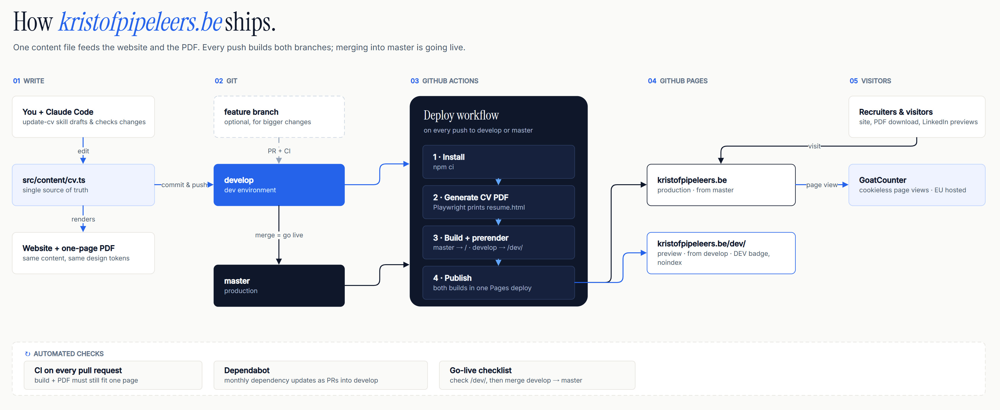

# kristofpipeleers.be

Personal CV website and matching PDF, both generated from a single content file.

| Environment | Branch    | URL                                |
| ----------- | --------- | ---------------------------------- |
| Production  | `master`  | https://kristofpipeleers.be        |
| Development | `develop` | https://kristofpipeleers.be/dev/   |

## Quick start

```bash
npm install
npx playwright install chromium   # once, for PDF generation
npm run dev                       # http://localhost:5173  (CV page: /resume.html)
```

## Updating the CV

1. Edit `src/content/cv.ts`. It holds all content for both the site and the PDF.
2. Run `npm run pdf` to regenerate `public/Kristof_Pipeleers_CV.pdf`. The script fails if the CV no longer fits on one page.
3. Commit to `develop` and push, then check https://kristofpipeleers.be/dev/.
4. Merge `develop` into `master` to go live.

With Claude Code you can just say *"update my CV: I started a new project at …"*. The `update-cv` skill handles steps 1–3.

## Stack

React 19, Vite, Tailwind CSS v4, TypeScript, Playwright (PDF), GitHub Actions and GitHub Pages.

## Architecture



Editable source: [`docs/architecture.drawio`](docs/architecture.drawio). Open it in draw.io or the VS Code Draw.io extension.
